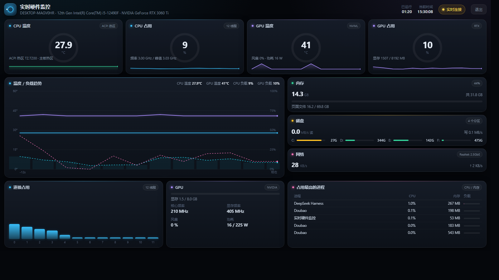

# 实时硬件监控 · SysMonitor

Windows 上的**单文件实时硬件监控**小程序：一个 exe，双击就能看到 CPU 温度、CPU 占用（含逐核）、GPU 温度/占用/显存、内存、磁盘、网络和占用最高的进程。

不依赖 Node.js、Python、PowerShell 脚本或任何第三方运行库——只用 Windows 自带的 .NET Framework 4.8。



## 功能

| 卡片 | 内容 |
|---|---|
| CPU 温度 | 当前温度 + 2 分钟曲线，超 75/85 °C 自动变色告警 |
| CPU 占用 | 总占用、逐逻辑核柱状图、当前频率 / 峰值频率 |
| GPU 温度 / 占用 | NVIDIA 显卡温度、利用率、显存、核心/显存频率、风扇、功耗 |
| 温度 / 负载趋势 | CPU/GPU 温度与负载同图，双 Y 轴，120 秒滚动 |
| 内存 | 已用 / 总量、页面文件 |
| 磁盘 | 读写速率 + 各固定分区占用条 |
| 网络 | 上下行速率（自动过滤 Loopback / isatap / Teredo 等虚拟网卡） |
| 进程 | 按 CPU 占用排序的 Top 5，附内存占用 |

界面是绿色 + 深色仪表盘风格，每张卡片独立自适应高度，整页按窗口高度铺满；窗口是 Edge/Chrome 的 `--app` 独立应用窗口（无地址栏、无标签页）。

## 使用

1. 双击 `dist/实时硬件监控.exe`（或自己编译一个）。
2. 弹出监控窗口；任务栏右侧托盘出现一个图标。
3. 停止监控：**关闭窗口**，或在页面点右上角「退出」，或托盘图标右键 → 退出。

重复双击不会开第二份：已运行时只会把窗口重新调出来。

> 程序是本机编译、无数字签名的 exe。若首次运行 Windows 提示「Windows 已保护你的电脑」，点「更多信息 → 仍要运行」。

## 数据来源与口径

| 指标 | 来源 | 说明 |
|---|---|---|
| CPU 占用 / 逐核 / 频率 | PDH 性能计数器 `Processor Information` | 1 秒采样 |
| CPU 温度 | PDH `Thermal Zone Information`（ACPI 热区） | **桌面机常见限制**：ACPI 热区给的是主板/机箱热区，可能长时间不动。装了并运行 [LibreHardwareMonitor](https://github.com/LibreHardwareMonitor/LibreHardwareMonitor) 后，程序会自动改读它的 `root\LibreHardwareMonitor` WMI 命名空间，拿到 CPU Package / 各核 DTS 温度，并在卡片角标显示 `LHM` |
| GPU | `nvidia-smi`（`--query-gpu=...`） | 温度、占用、显存、频率、风扇、功耗均为驱动真实值；无 NVIDIA 卡时不显示 GPU 卡片数据 |
| 内存 | `GlobalMemoryStatusEx` | 物理内存 + 页面文件 |
| 磁盘 | PDH `LogicalDisk` | `_Total` 读写字节/秒 |
| 网络 | PDH `Network Interface` | 各网卡收发速率求和 |
| 进程 | `System.Diagnostics.Process` 差分 | 每 3 秒刷新一次 |

采样循环每秒一次，历史保留 300 秒（刷新页面不丢趋势）。

## 项目结构

```
.
├─ src/
│  ├─ MonitorApp.cs      # 全部逻辑：采集器 + HTTP/SSE 服务 + 托盘 + 窗口管理
│  ├─ index.html         # 仪表盘前端（编译进 exe 内嵌资源）
│  └─ app.ico            # 程序图标
├─ build.ps1             # 用系统自带 csc.exe 编译
├─ dist/实时硬件监控.exe  # 已编译好的成品
├─ screenshots/
└─ .github/workflows/build.yml
```

程序内部：单个进程里跑着
1. 采集线程（PDH / Win32 / nvidia-smi，1 Hz）；
2. 自写的极简 HTTP 服务（`TcpListener` + 手写 HTTP，**不占 http.sys 端口授权、不需要管理员**），提供 `/`、`/stream`(SSE)、`/api/snapshot`、`/api/quit`；
3. 托盘图标 + 窗口监听（窗口消失 4 秒即退出）。

## 编译

只需要 Windows 自带的 .NET Framework 4.8，**不需要装 SDK**：

```powershell
.\build.ps1
```

产物为 `dist\实时硬件监控.exe`（约 100 KB）。等价的原始命令：

```powershell
& "$env:WINDIR\Microsoft.NET\Framework64\v4.0.30319\csc.exe" `
  /nologo /target:winexe /platform:anycpu /optimize+ /codepage:65001 `
  /win32icon:src\app.ico /resource:src\index.html,SysMonitor.index.html `
  /r:System.dll /r:System.Drawing.dll /r:System.Windows.Forms.dll /r:System.Management.dll `
  /out:dist\实时硬件监控.exe src\MonitorApp.cs
```

改界面只改 `src/index.html`（重新编译即生效，无需外部资源文件）。

## 已知限制

- 仅 Windows 10 / 11（依赖 .NET Framework 4.8、PDH、Edge/Chrome 的 `--app`）。
- CPU 内核温度受 Windows 限制：不装 LibreHardwareMonitor 时只能读 ACPI 热区。
- GPU 部分只支持 NVIDIA（走 `nvidia-smi`）；AMD / Intel 核显暂无数据。
- 窗口依赖系统上的 Edge 或 Chrome；都没有时退回默认浏览器打开。

## License

MIT，见 [LICENSE](LICENSE)。

---

**English**: A single-file Windows hardware monitor (.NET Framework 4.8, no runtime dependencies). Shows live CPU/GPU temperature and load, memory, disk, network and top processes in a dark dashboard; the UI is served by an embedded HTTP/SSE server on `127.0.0.1` and opened in a browser `--app` window. Build with `build.ps1` (uses the built-in `csc.exe`, no SDK required). MIT licensed.
